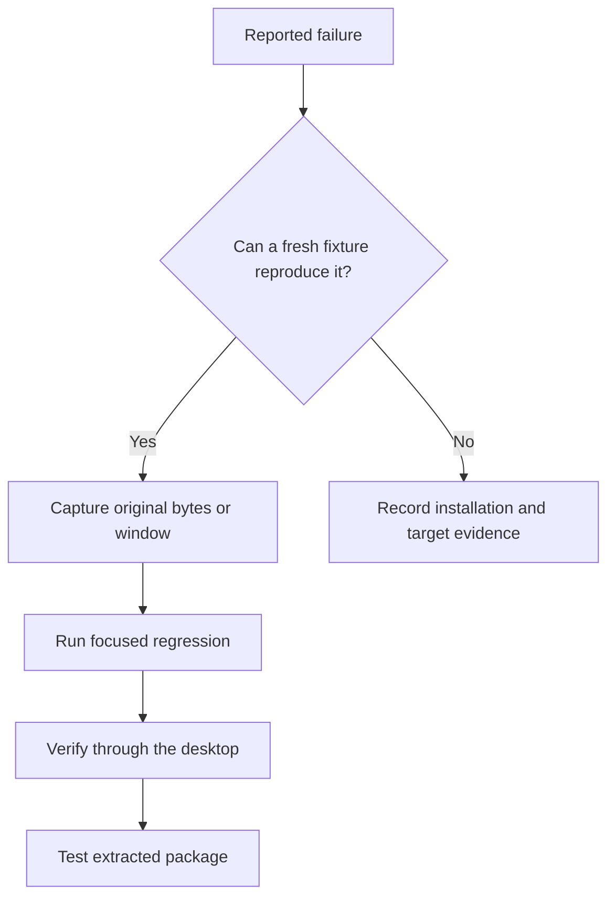

# Debugging guide

Start with [engineering lessons](ENGINEERING_LESSONS.md) and [regression history](REGRESSION_HISTORY.md). Use the [milestone report](FIRETIER_AUDIT.md) to find measured results and the actual screenshots.

## Reproduce in isolation

Run from the Firetier source directory on Windows. Automation assumes an interactive Windows desktop and a writable temp folder. Both Firetier paths below must be dedicated to the test. A real Roblox installation is unnecessary.

```powershell
$qaRoot = Join-Path ([System.IO.Path]::GetTempPath()) ([guid]::NewGuid().ToString())
New-Item -ItemType Directory -Path $qaRoot | Out-Null
$env:TMPDIR = $qaRoot
$env:FIRETIER_HOME = Join-Path $qaRoot 'home'
$env:FIRETIER_LOCALAPPDATA = Join-Path $qaRoot 'fixture-install'
python -m unittest discover -s tests -v
python tests/desktop_workflow.py "$qaRoot/workflow" docs/evidence
python tests/capture_windows.py docs/evidence
python tests/stress_windows.py docs/evidence/performance.json
python packaging/build_windows.py "$qaRoot/Firetier-Windows.zip"
python tests/package_windows.py "$qaRoot/Firetier-Windows.zip" docs/evidence
```

Use a fresh workflow directory each run. The unit suite requires Python and Tk. Capture and soak tests additionally use Pillow, psutil and pywin32. The portable build recipe uses the official Windows x64 CPython installation with Tcl/Tk 8.6 and the runtime components listed in the build script. The packaged application itself uses the bundled runtime. The historical before image is retained as the baseline for comparisons.

## What to inspect

| Observation | First check |
|---|---|
| A profile disappeared | Open Diagnostics and select the failed file row for details. Preserve its original under the profiles directory. Inspect format, version, game, rule state, timestamp and filename. Deleted files are under trash. |
| Preferences reset after restart | Inspect the status bar, firetier.log, settings.previous.json and settings.damaged-*.json. A reset from Diagnostics also records settings.before-reset.json. Close Firetier before manually recovering a copy. |
| Restore refused | Read the full target path and backup ID. Compare the payload's SHA-256 with meta.json. Choose another intact snapshot if the digest disagrees. Keep the suspect folder for investigation. |
| Interrupted write | Inspect the committed file first. Compare its bytes to the backup. An orphan .tmp is staging data and can be examined separately. |
| A profile seems applied but has no in-game effect | Check the selected target path, allowed flags, actual on-disk values, intended launcher and restart. The preview draws an approximation. A verified local write only establishes what was in the file. |
| Diagnostics shows a process warning | Record the reported Windows query error. An unavailable process query leaves running state unknown. Copy the report for the full text. |
| UI stalls | Record active tab, number of profiles and entries, fresh or warm preview state, and time to process a UI event. Record working set and Tk image count over repeated identical cycles. |



## Recovery scope

Preferences recover automatically from the prior valid copy when possible. Profile isolation preserves unreadable originals for repair. Target restoration is explicit from Backups. User edits made since the last profile save live in memory. The app requests confirmation on normal close. A process crash can lose those unsaved edits. Test power interruption, cold-machine startup and high-DPI layouts separately before a general release.

