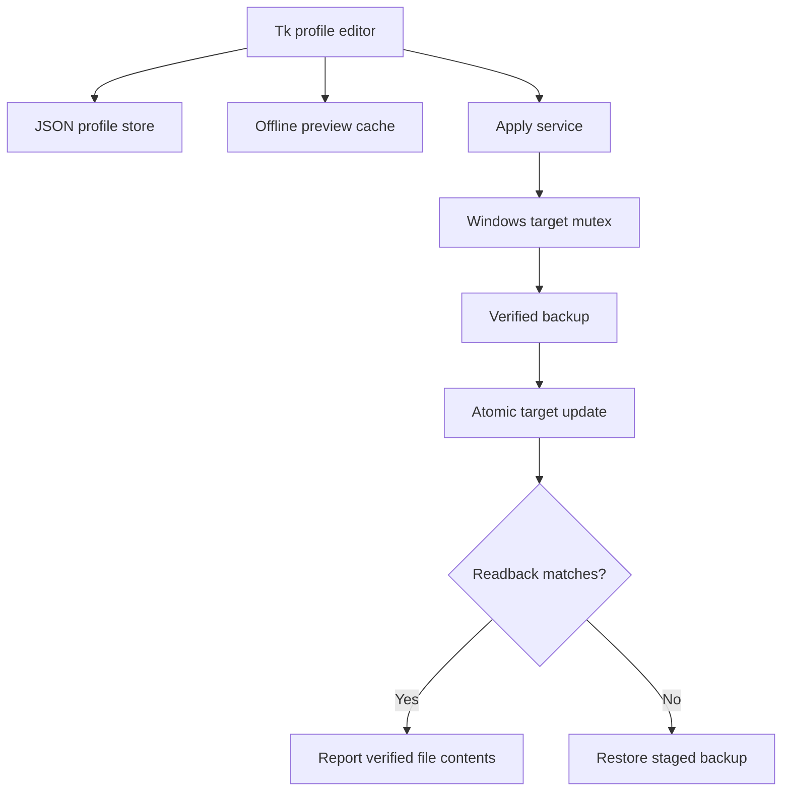

# Engineering lessons

Read these notes and [the regression history](REGRESSION_HISTORY.md) before modifying profile identity, settings, import, apply, restore, rendering or packaging.

1. **Check backup integrity before committing a restore.** Capture the destination once, stage the backup beside the destination, verify the staged bytes, and replace atomically. A post-write mismatch is already a user-visible mutation.
2. **Use one local identity.** On disk, the owning filename selects the profile to update. Exports carry a portable ID. An import receives a fresh local ID. Test duplicated files with stale embedded IDs.
3. **Validate both sides of persistence.** Input types, nesting, schema version, finite timestamps and serialized byte size affect whether a file can reopen. Keep faulty files available and give diagnostics enough information to find them.
4. **Enforce write policy in the engine.** The archive-only check must survive direct calls, export/reimport and Replace mode. Treat archived asset references as untrusted data. Keep the local renderer's boundary visible.
5. **Protect the whole transaction.** Serialize cooperating writers around read, backup, replace, verify and rollback. A mutex is automatically released on process death. External editors need independent change detection.
6. **Separate pending edits from navigation.** A file chooser or name prompt can still be cancelled after a save prompt. Clear the dirty indicator only once the save or actual profile switch succeeds.
7. **Treat the Tk thread as a limited resource.** Move slow Windows probes off it, call Tk only on the UI thread, cap image retention, and measure both hot and fresh paths.
8. **Exercise the delivered entry point.** Unpack the produced archive into a path with spaces, remove system Python from PATH, start Firetier.bat, observe a real window and close it normally. Test two independent processes for persistence.

